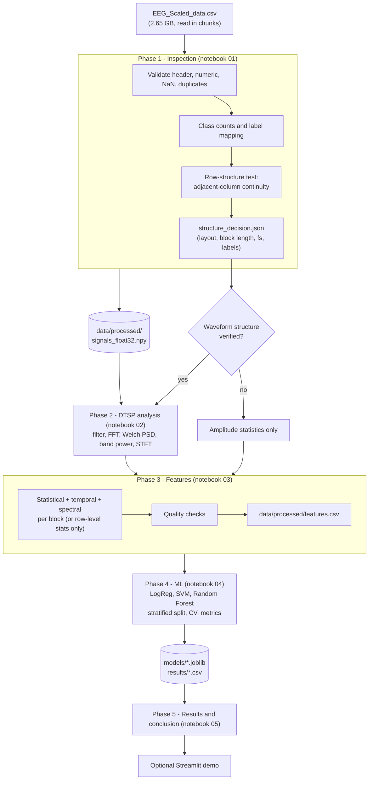

# Automated Epileptic Seizure Detection from EEG Signals Using Digital Signal Processing and Machine Learning

A Digital Signal Processing (DTSP) and machine-learning project on a CHB-MIT-derived EEG dataset. The pipeline first **verifies how the data are
organised** and only then applies DSP and ML, so every analysis is justified by what the file actually contains.

> **Status:** code, notebooks and unit tests are complete. The results section below is filled in only after you run the notebooks on the real
> `EEG_Scaled_data.csv` (see [Results](#results)). Nothing in this README is a measured result.

## Project summary (for a portfolio)

Built an end-to-end EEG seizure-classification pipeline in Python: chunked ingestion of a 2.65 GB CSV, an empirical test of the data's signal structure
(rather than assuming it), DSP analysis (Butterworth filtering, FFT, Welch PSD, band power, STFT spectrograms), vectorised feature extraction, and a leakage-aware
comparison of Logistic Regression, SVM and Random Forest using imbalance-appropriate metrics (sensitivity, specificity, PR-AUC). Explicit documentation of what the
dataset cannot support (no patient IDs, undocumented sampling rate), so no unjustified generalisation claims are made.

## Architecture



## Dataset and attribution

* **Dataset:** "CHB-MIT EEG Dataset (.CSV)" on Kaggle by *subirbiswas19*: <https://www.kaggle.com/datasets/subirbiswas19/eeg-dataset>.
  File used: `EEG_Scaled_data.csv` (not included in this repository; download it and place it in the project root).
* **Source data:** CHB-MIT Scalp EEG Database (PhysioNet): 22 subjects (23 cases), EDF recordings at 256 Hz, 16-bit, mostly 23 channels, 10-20 system.
  <https://physionet.org/content/chbmit/1.0.0/>
* **Please cite:** Shoeb, A. *Application of Machine Learning to Epileptic Seizure Onset Detection and Treatment*, PhD thesis, MIT, 2009;
  Goldberger AL et al., *PhysioBank, PhysioToolkit, and PhysioNet*, Circulation 101(23):e215-e220, 2000.
* The Kaggle creator reports 11,233 rows x 36,865 columns (36,864 signal columns + `target`), 9,799 non-seizure and 1,434 seizure rows, standard-scaled.
  These are **claims that Phase 1 checks**. The Kaggle page does not document the row layout, sampling rate, channels or label meaning.

## What the CSV can and cannot support

| Question | How this project handles it |
|---|---|
| Is a row a waveform? Where do channels/segments start? | Measured in Phase 1 from adjacent-column continuity; verdict `blocks`, `single_sequence` or `unverified` |
| Sampling rate | Not in the CSV. Default: **normalised frequency** (cycles/sample). Hz and delta-gamma bands only if you explicitly set an assumed rate in notebook 01 |
| Which label is "seizure" | Inferred by matching class counts to the creator's reported counts and flagged as *inferred* |
| Physical units | Lost (z-scores) |
| Patient / recording IDs | Absent, so **patient-independent evaluation is impossible**; scores are for a random segment-level split and are likely optimistic |
| Unverified structure | Spectral and temporal features are skipped; only order-independent row statistics are used |

## Repository layout

```text
EEG Signal Classification DTSP/
├── EEG_Scaled_data.csv            # you provide (git-ignored)
├── data/processed/                # cache + features.csv (git-ignored)
├── notebooks/
│   ├── 01_data_inspection.ipynb
│   ├── 02_dtsp_signal_analysis.ipynb
│   ├── 03_feature_extraction.ipynb
│   ├── 04_model_training.ipynb
│   └── 05_results_and_conclusion.ipynb
├── src/eeg_signal_classification/
│   ├── data_loader.py             # chunked CSV scan, cache, label mapping
│   ├── preprocessing.py           # scaling check, row-structure investigation
│   ├── signal_analysis.py         # Butterworth, FFT, Welch, band power, STFT
│   ├── feature_extraction.py      # vectorised features + quality report
│   ├── train.py                   # models, splits, cross-validation
│   ├── evaluate.py                # metrics and plots
│   └── utils.py                   # paths, seeds, JSON helpers
├── app/streamlit_app.py           # optional demo
├── models/  results/  tests/
└── pyproject.toml  uv.lock
```

## Installation and execution (Windows, VS Code, uv)

```powershell
# in the project folder (PowerShell)
uv sync                       # creates/updates .venv from pyproject.toml + uv.lock
uv run pytest -q              # optional: unit tests on synthetic data
uv run jupyter lab            # or open the notebooks in VS Code and pick the .venv kernel
```

In VS Code choose the interpreter `.venv\Scripts\python.exe` as the notebook kernel. Run the notebooks **in order** (each reads the previous one's outputs):

| # | Notebook | Produces | Typical time |
|---|---|---|---|
| 1 | `01_data_inspection` | signal cache, `results/structure_decision.json`, summaries | several minutes (one pass over the CSV) |
| 2 | `02_dtsp_signal_analysis` | figures, `band_power_comparison.csv`, `class_mean_psd.npz` | about 1 min |
| 3 | `03_feature_extraction` | `data/processed/features.csv`, effect sizes | a few minutes |
| 4 | `04_model_training` | `models/*.joblib`, `results/model_metrics.csv`, figures | minutes (SVM/RF) |
| 5 | `05_results_and_conclusion` | `results/results_summary.md`, final figures | about 1 min |

Optional demo: `uv run --group app streamlit run app/streamlit_app.py`.

Memory: signals are read in chunks and then memory-mapped from `data/processed/signals_float32.npy` (about 1.7 GB on disk for the expected shape). Delete `data/processed/cache_meta.json` to force a rebuild.

## Dependencies

Runtime (`uv add`): numpy, pandas, scipy, matplotlib, seaborn, scikit-learn, joblib.
Dev group: jupyterlab, ipykernel, nbconvert, nbformat, pytest. App group: streamlit.

## Method summary

* **Filtering:** 4th-order Butterworth band-pass as second-order sections, zero-phase (`sosfiltfilt`). Shown as a DSP demonstration; features use the data as provided because earlier filtering is unknown.
* **Spectrum:** FFT magnitude, Welch PSD, band and relative band power, STFT spectrogram, class-level median PSD with IQR.
* **Features (per block):** mean, std, variance, RMS, energy, peak-to-peak, skewness, kurtosis, line length, Hjorth mobility/complexity, band power and relative band power,
  dominant frequency, spectral centroid, spectral entropy, 95 % spectral edge.
* **Models:** Logistic Regression (baseline), SVM (RBF), Random Forest; scaler inside the pipeline; `class_weight` for imbalance; stratified 80/20 split; 5-fold CV on the training set.
* **Metrics:** accuracy, balanced accuracy, precision, sensitivity, specificity, F1, MCC, ROC-AUC, PR-AUC, confusion matrices.
* **Reproducibility:** fixed seed (42), relative paths via `pyproject.toml` discovery, cached intermediates, locked dependencies (`uv.lock`).

## Results

*Not yet populated.* After running notebooks 01-05 on the real data, copy the contents of `results/results_summary.md` and the key figures from `results/figures/` here.
Report the numbers exactly as produced and keep the limitation statements below next to them.

## Limitations

* No patient or recording identifiers: random segment-level splitting lets near-identical neighbouring segments appear in both train and test sets, so scores are optimistic and do **not** show generalisation to new patients.
* Sampling rate, channel arrangement, segment length and the meaning of `target` are not documented in the CSV; the project records what could be inferred and what could not.
* Column-wise standard scaling removed physical units and may itself have been fitted on all rows.
* Segment-level classification is not event-level seizure detection (no false-alarms-per-hour or latency).
* Not a medical device; no clinical validity is claimed.

## Possible extensions

Use the original EDF files with official annotations for patient-wise evaluation; event-based metrics; probability calibration; a 1D CNN once the data structure is verified; an optional GenAI report assistant.

## Tests

`uv run pytest -q` runs 11 tests on **synthetic** signals only (to check the code, e.g. that shuffled columns are rejected as a waveform, that an injected rhythm is recovered, that labels stay aligned). They say nothing about real-data performance.
